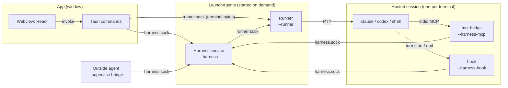

# Agent MCR architecture

Agent MCR (Agent Mission Control Room) is a local harness for a group of coding agents on one Mac. It runs Claude Code, Codex and shell sessions in terminals that outlive the app, lets the sessions talk to each other, puts the ones that need a person in front of that person, and keeps a search index of past sessions.

This document shows how the parts fit and why they are shaped this way. It describes what is built. The design the harness is growing towards, with its signed decisions (D1 to D12), is in [docs/AGENT_HARNESS_DESIGN.md](docs/AGENT_HARNESS_DESIGN.md). Build commands are in [README.md](README.md); the file-by-file reference and the rules for changing the code are in [CLAUDE.md](CLAUDE.md).

## Processes

One binary, `agent-mcr`, runs in several roles. The role is chosen by the first argument, before any window code starts.

| Process | Started by | Owns | Restart |
|---|---|---|---|
| **App** | The person | The window, the access list, the session index | Free: sessions keep running |
| **Runner** (`--runner`) | LaunchAgent `cc.lambdahouse.agent-mcr.runner` | The agents' terminals (PTYs), 4 MB of output per session, exit codes | Ends every session. Avoid |
| **Harness service** (`--harness`) | LaunchAgent `cc.lambdahouse.agent-mcr.harness` | Session state, tasks, messages, reports, the bulletin board, both MCP servers | Safe: bridges reconnect and replay their handshake |
| **Bridges** (`--harness-mcp`, `--supervise`, `--mcp`) | The agent, as an MCP server command | Nothing: they copy stdio to a socket | With their agent |
| **Hook** (`--harness-hook`) | The agent, on its own events | Nothing: one report, then exit | — |

The split follows one rule: **running is separate from deciding, and both are separate from viewing.** The runner has no policy, so it almost never needs a new build and agents survive everything else being rebuilt. The harness service holds the policy and can be restarted at any time. The app is a view: closing it stops nothing.

Both units exit after ten idle minutes with nothing running, and neither starts at login.

## What a hosted session gets

The harness passes everything per launch. Nothing is written into the person's own agent configuration.

| | Claude Code | Codex |
|---|---|---|
| State reports | `--settings` with hooks: SessionStart, UserPromptSubmit, PostToolUse, Notification, Stop | `-c notify=…` (turn end only) |
| `mcr` tools | `--mcp-config` | `-c mcp_servers.mcr.*` |
| Start-up note | `--append-system-prompt` | `-c developer_instructions=…` |
| Working rules | Two skills from a per-launch plugin (`agent-mcr:peers`, `agent-mcr:reporting`) | The `guide` tool |

Everything specific to one agent program is in one adapter (`agents.rs`): its command line, the files a launch reads, how it reports, how a turn is interrupted. `harness.rs` asks the adapter and never compares agent names, so another agent is another adapter.

## State and attention

Session state is `starting`, `working`, `idle`, `waiting`, `unknown` or `exited`. It comes from the agent's own hooks, not from guessing at terminal output. `apply_hook` is the pure state machine and the place to test changes.

Three things no hook reports are handled separately. Each was found in a live run:

- A Claude session that asks something before it starts (trust this folder?) fires no hook: a session that printed, went quiet and never reported is marked as waiting.
- Codex reports turn ends of other threads (its title writer, subagents): only the session's own thread counts, and the transcripts say which that is.
- Codex reports nothing before its first turn ends: a task is typed only when its input box is on screen.

A session that needs the person carries an **attention** mark, shown in the Live list and as a notification:

| Kind | Raised by | Cleared when |
|---|---|---|
| `permission` | The agent's permission prompt, or a start-up question | The agent moves on |
| `assessment` | The agent's own `report` with `needs_human` | The person types into the session |
| `notification` | The agent's `report` with `done`, or a terminal notification | The person looks at the session |

**Only the person answers a permission prompt (D6).** While a session waits on one, the supervisor's input to it is refused, and notices are never typed into it.

## Tools between sessions

Two MCP servers, both served by the harness service.

**`mcr`, for every hosted agent:**

| Purpose | Tools |
|---|---|
| See | `whoami`, `list_peers` (sessions in the caller's folder first, with their role), `guide` |
| Say | `set_status` (what it is doing, and its role) |
| Talk | `send_message`, `ask`, `reply`, `read_inbox`, `listen` |
| Report | `report`: `needs_human` or `done`, at the agent's own judgment |
| Leave notes | `bulletin_post`, `bulletin_read`, `bulletin_remove` |

**Supervisor, for the Supervisor session** (and for an outside agent only while the person has allowed it): create, resume, restart and end sessions; assign tasks and wait for them; read terminals; list messages, reports and waiting sessions; manage the bulletin board. Typing raw input into a terminal asks the person each time.

How text reaches an agent matters more than which tool sent it:

- **A message body is never typed into a terminal.** When a session is idle, a fixed notice is typed ("new message in your inbox") and the agent reads the message with a tool, labelled as data from another session.
- **A task is words, not a command.** It can't start with `!`, `#` or `/`, and a shell can't be given one.
- **A bulletin note is read with a tool, never injected.** A note needs an expiry (1 hour to 14 days), can end with its author's session, and is scoped to a folder or to all sessions.
- **Sending is limited**: 40 messages and 6 reports per session in ten minutes, which stops answer loops.

## Trust boundaries

There are three, and they are different in kind.

### 1. The webview is untrusted

It renders Markdown and terminal output written by agents, so anything in it may be hostile. Everything that touches the system goes through Rust, and Rust decides on its own.

- **Capabilities** grant only `core:default` and window destroy. The JS file system, dialog, shell and opener plugins are not exposed.
- **Access list** (`Access` in `main.rs`, saved to `access.json`). Each grant is a native confirmation Rust shows itself: the folder picker in Live, the agent documents, the Sessions index, memory views. No command adds a path because the webview passed it. Dropped files, command-line paths and files handed over by the system are not opened and grant nothing.
- **Session folders** (the folders agents work in) are found by Rust from the harness and the index. Inside one, only the agent files open: `CLAUDE.md`, `AGENTS.md`, rules, plans, skills and the like, never the folder's other files.
- **Rendering**: markdown-it with raw HTML off, a strict CSP, Mermaid at its strict security level, a navigation guard that keeps the window on the app's own pages. Remote images are placeholders until the person allows them.
- **Symlinks** inside a granted folder are followed only to Markdown files and images.

### 2. Local sockets identify their caller by the kernel

`runner.sock` and `harness.sock` are Unix sockets in a `0700` folder. A caller's identity is its process, as the kernel reports it (`peer.rs`): the user, the program, and which hosted session's process tree it belongs to. Nothing a caller says about itself is believed.

- The runner answers only Agent MCR itself, and only from outside every hosted session.
- A hosted session gets the `mcr` tools and nothing else. A hook report counts for the session its process runs in.
- The supervisor tools belong to the Supervisor session.

### 3. What this does not protect

**Every agent runs as the person's macOS user. The socket checks are not a wall between that user's programs.** They stop a hosted agent from reaching the sockets with one plain command, and they give correct attribution. A program written to get around them can, because it runs as the same user. Trust also rests on the binary's path: an agent that rebuilds the app passes as the app. Real isolation would need a sandbox per agent; that is a recorded option, not something built.

The harness holds no third-party credentials and makes no network request of its own, except images the person allowed. There is no updater.

## The app

Two surfaces in one window (`App.tsx`).

**Sessions** (`SessionWorkspace.tsx`):

- **Live** (`LiveWorkspace.tsx`, `TerminalPane.tsx` with xterm.js): the hosted sessions by working folder, their state, subagents and running shells, and their terminals. Terminal bytes go from the runner to the webview over a raw channel and never pass through the harness service.
- **Search**: past Claude and Codex sessions from the index, with activity, subagents, usage, memories and linked work. A past session can be resumed in Live.

**Documents** (`AgentPanel.tsx`, `DocumentPanel.tsx`): the agents' Markdown and nothing else. Instructions, rules, memory, plans, skills, agents and commands, grouped by the folder sessions work in, then the agents' own folders. Changes since the person last read a document are marked. The reader has tabs, a table of contents, find, a source editor (CodeMirror 6) and export. A memory opened from Sessions gets its own reader window, which shares preferences read-only and nothing else.

Markdown is rendered synchronously (markdown-it), then enhanced: Shiki highlights code and Mermaid draws diagrams as they scroll into view, so text is readable at once.

## The session index

`sessions.rs` reads the Claude and Codex transcript files incrementally into SQLite (`session_db.rs`): checkpoints per file, paged events, usage records deduplicated across restarts. It is derived data: revoking the Sessions grant clears it.

It is read three ways: the Search view, the usage pane in Live, and a read-only analysis MCP server (`session_mcp.rs`, bridge `--mcp`) that an agent can be given after a native confirmation.

Two rules keep it honest. Status inferred from files is never shown as verified process liveness: a transcript written a minute ago does not prove a running agent. And figures come from the transcripts, never from what an agent says about itself.

## Where data lives

`~/Library/Application Support/agent-mcr/`, all files `0600`:

| File | Holds | Truth or derived |
|---|---|---|
| `access.json` | What the person allowed | Truth |
| `harness-state.json` | Session states, tasks, messages, reports, bulletin notes | Truth |
| `runner.sock`, `harness.sock` | — | — |
| `sessions/index.sqlite` | The index of past sessions | Derived |
| `read-state/` | Copies of agent documents as last read | Derived |
| `claude-*.json`, `claude-plugin/` | What a Claude launch reads, rewritten before every launch | Derived |

UI state (panel sizes, tabs, theme, folders pinned in Live) is in the webview's localStorage.

## Build

Local builds only (D12): `npm run build:app` makes `Agent MCR.app`. The code must still compile on Linux. CI runs the TypeScript build, Vitest, `cargo clippy` and `cargo test`. There are no published builds.

## Design choices

| Choice | Reason |
|---|---|
| One binary in several roles | One thing to build, sign and keep in step; a version mismatch between the parts is detected and named |
| Runner without policy | It never needs a restart for a new feature, so agents survive rebuilds |
| State from hooks, not from the screen | A screen can be imitated and changes with every agent release; a hook is the agent's own word |
| Identity from the kernel | A caller can't claim to be another session by passing its id |
| Fixed notices, bodies read by tool | Text from one agent never arrives in another's prompt as if a person typed it |
| Only the person answers prompts | A supervisor that approves for the person removes the one control they have |
| Per-launch configuration | The person's own agent setup is never changed, and removing the app leaves it as it was |
| No network client | No credentials to hold, nothing to leak, and the app's traffic is easy to check |
| All system access in Rust, behind an access list | Rendered text is untrusted, so a rendering bug must not become file access |
